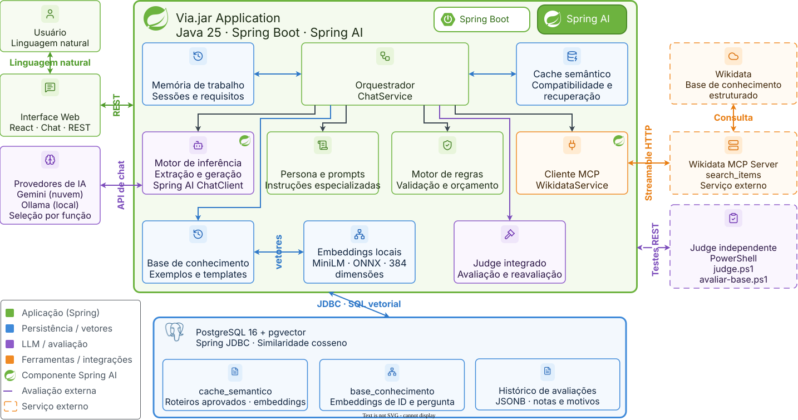

# V*ia*.jar

     

Sistema especialista conversacional para recomendação de destinos e planejamento personalizado de viagens, desenvolvido na pós-graduação em Desenvolvimento Web do IFBA.

## Funcionalidades

- Chat com coleta de requisitos e manutenção do contexto da viagem.
- Recomendação de destinos e geração de roteiros com distribuição do orçamento.
- Motor de inferência com Gemini ou Ollama e consulta ao Wikidata via MCP.
- Base de conhecimento e cache semântico com embeddings locais e busca vetorial no PostgreSQL (pgvector).
- LLM-as-a-Judge com histórico de avaliações no PostgreSQL e scripts independentes.

## Como executar

**Pré-requisitos:** Git, Docker com Docker Compose e navegador. O primeiro uso requer internet. Não é necessário instalar Java, Maven, Node.js, Ollama ou PostgreSQL na máquina.

### 1. Clonar o repositório

```bash
git clone https://github.com/GuiRezende/via-jar.git
cd via-jar
```

### 2. Configurar o ambiente

Crie o `.env` a partir do `.env.example`:

```powershell
Copy-Item .env.example .env # Windows (PowerShell)
```
```bash
cp .env.example .env # Linux/macOS
```

- **Gemini (padrão):** obtenha uma chave no [Google AI Studio](https://aistudio.google.com/apikey) e preencha `GOOGLE_API_KEY` no `.env`.
- **Ollama (sem chave):** deixe `GOOGLE_API_KEY` vazio, defina `EXTRACTOR_PROVIDER`, `INFERENCE_PROVIDER` e `JUDGE_PROVIDER` como `ollama` no `.env` e confira a seleção na interface.

O PostgreSQL utiliza a senha definida em `POSTGRES_PASSWORD` (padrão local: `viajar`).

### 3. Subir os contêineres

```bash
docker compose config --quiet
docker compose up --build -d
docker compose ps -a
docker compose logs -f models backend
```

A primeira execução baixa os modelos. O backend cria automaticamente a extensão `vector`, o schema `viajar` e suas tabelas, além de indexar a base de conhecimento. `models` em `Exited (0)` indica sucesso; aguarde `Started ViaApplication` nos logs do backend. Use `Ctrl+C` para sair dos logs.

| Serviço | Endereço |
| --- | --- |
| Frontend | [http://localhost:5173](http://localhost:5173) |
| Backend | [http://localhost:8080/api/avaliacoes](http://localhost:8080/api/avaliacoes) |
| Ollama | http://localhost:11434 |
| PostgreSQL + pgvector | localhost:5433 (banco e usuário: `viajar`) |

Para encerrar: `docker compose down`. Para retomar: `docker compose up -d`.

## Demonstração

1. Abra o frontend e selecione os provedores de extração, inferência e avaliação.
2. Envie: “Vamos de Salvador para Recife em maio de 2027. Somos dois adultos, temos R$ 6.000 para quatro dias e gostamos de museus e gastronomia. Evite trilhas longas.”
3. Confira o roteiro, o orçamento, as fontes (quando disponíveis) e a nota de avaliação.
4. Após obter um roteiro aprovado, repita a solicitação em uma nova conversa e confirme a oferta para testar o cache.
5. Consulte os menus **Roteiros aprovados** e **Roteiros reprovados** para examinar as avaliações.

## Arquitetura e avaliação


- **Backend:** Java 25, Spring Boot 4.1.1, Spring AI 2.0.1, Spring MVC, Spring JDBC, HikariCP e Maven.
- **Frontend:** React 19.3.0 e Vite 8.3.8.
- **LLMs:** Gemini (`gemini-3.5-flash-lite`) e Ollama (`qwen3.5:2b`).
- **Banco vetorial:** PostgreSQL 16 com pgvector 0.8.7 (versão validada), embeddings locais `paraphrase-multilingual-MiniLM-L12-v2` (384 dimensões), ONNX Runtime e busca exata por similaridade cosseno via SQL.
- **Cache:** somente roteiros aprovados são armazenados; a reutilização filtra requisitos compatíveis, ordena candidatos por similaridade cosseno e exige confirmação do usuário e nova aprovação.
- **Judge:** avalia preferências (25%), restrições (25%), coerência (20%), orçamento (15%) e completude (15%). A aprovação exige nota ≥ 80/100 e os nove indicadores eliminatórios verdadeiros.

## Avaliação independente

Com PowerShell, execute `scripts/judge.ps1` para avaliar uma pergunta e resposta ou `scripts/avaliar-base.ps1` para testar a base de conhecimento com o backend em execução.

## Persistência e observações

- `viajar.base_conhecimento`: exemplos indexados com embeddings da pergunta e do identificador; `conhecimento.json` permanece como fonte original.
- `viajar.cache_semantico`: roteiros aprovados, assinaturas e embeddings; persistidos no volume `postgres-data`.
- `viajar.historico_avaliacoes`: avaliações aprovadas, reprovadas e indisponíveis, com detalhes em JSONB.
- `data/models/` e volume `ollama-data`: modelos de embeddings e chat, respectivamente.
- `docker compose down` preserva os dados; `docker compose down -v` remove os volumes do PostgreSQL e do Ollama, incluindo a base indexada, os roteiros em cache e o histórico de avaliações.
- Em caso de falha, consulte `docker compose logs frontend backend ollama models postgres`.
- Não versione o `.env` ou `data/`. A demonstração não possui autenticação na API de avaliações.
- O sistema sugere roteiros e orçamento; preços, horários e disponibilidade devem ser confirmados com os prestadores. O Wikidata requer internet.
